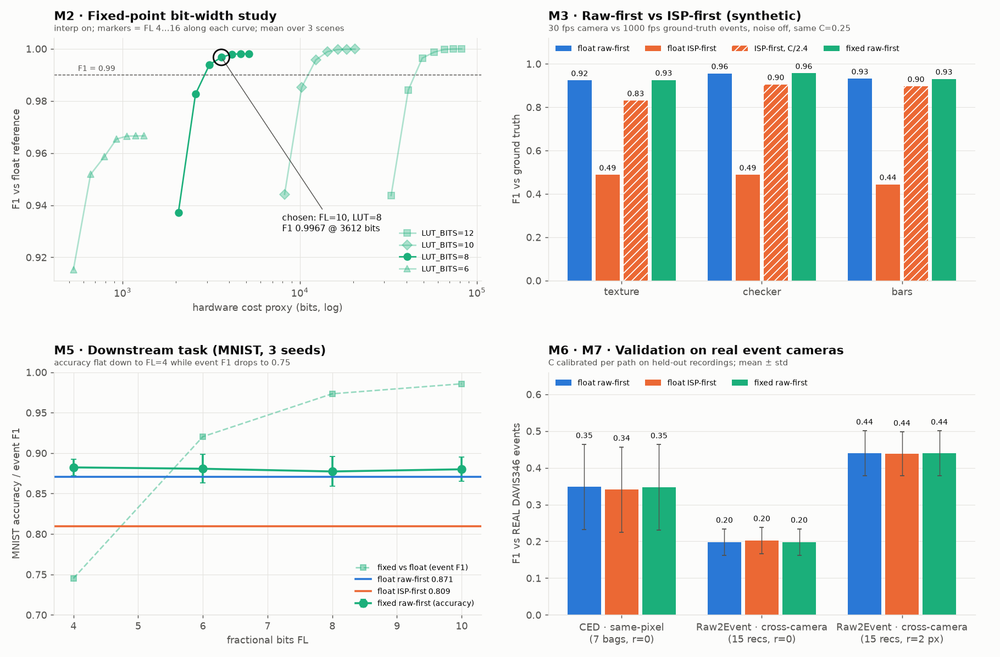
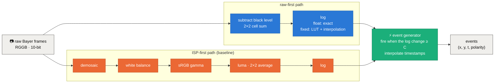
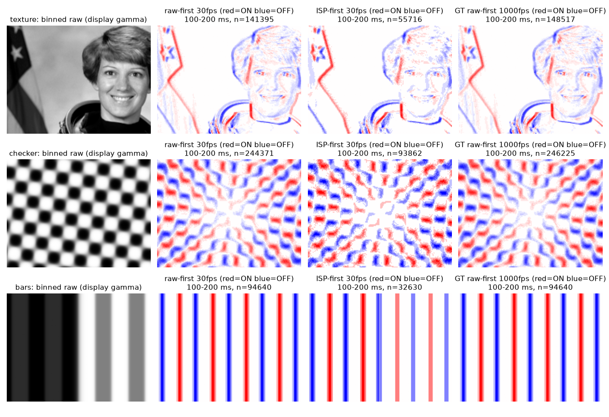
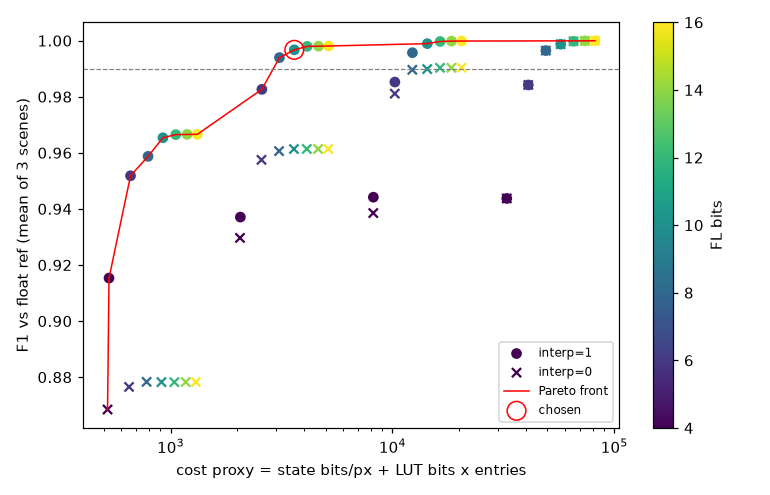
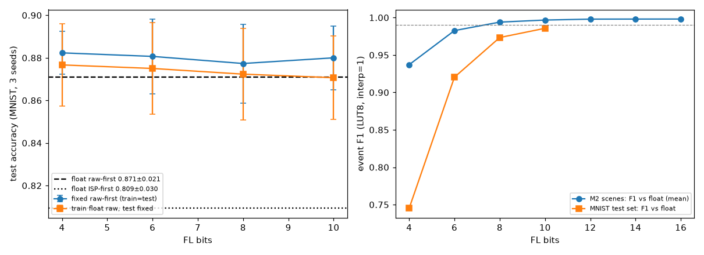
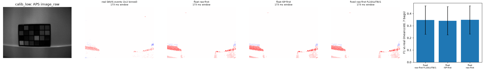
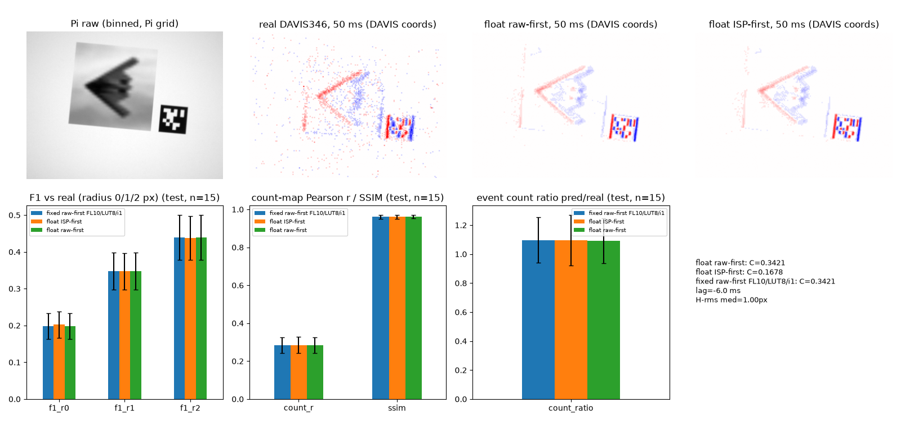

<div align="center">

# ⚡ raw2event-fx

### Turning a raw Bayer camera into an event camera, with a bit-accurate fixed-point C++ core

*Designed and tuned on synthetic scenes where ground truth is known, then validated on **real event-camera recordings** from two public DAVIS346 datasets.*

<br/>


[](LICENSE)


</div>

---

## TL;DR

- **What:** an emulator that converts **raw Bayer frames** from an ordinary camera into **event-camera output** (per-pixel log-brightness change events). It has a float reference model, and a **fixed-point C++ generator** with an integer-only hot path: the kind of core you would put on an FPGA, an ASIC or a microcontroller.
- **How we tested it:** **7 experiments in two phases.**
  - **Phase 1, synthetic:** scenes with exact ground truth were used to choose the bit widths, compare *raw-first* against *ISP-first* input, measure speed, and test a downstream classifier.
  - **Phase 2, real data:** the same generators were run on **two public datasets that pair raw frames with real DAVIS346 event-camera recordings**: CED and Raw2Event.
- **Key results** (all measured):
  - 🔢 A **10-fractional-bit, 257-entry-LUT** design (14 bits of state per pixel) reproduces the float model at **F1 0.9967**, with a cost proxy ~23x below the 16-bit design.
  - ⏱️ **2.04 ns per pixel**, giving **5,458 fps at 346×260** and **619 fps at 720p** on one CPU thread.
  - 🧠 Classification accuracy holds **down to 4 fractional bits**.
  - 📷 On **real** sensors the fixed-point core tracks the float model to within **0.0011 F1** (CED) and **0.0002 F1** (Raw2Event).
- **The honest twist:** on synthetic data, raw-first beats ISP-first by about 0.45 F1. On **real** data, once each path's threshold is calibrated, **they tie**. Most of the synthetic gap turned out to be gamma rescaling the contrast threshold.

<div align="center">



<sub>The four panels: bit-width trade-off (M2), raw-first vs ISP-first on synthetic data (M3), downstream task (M5), real event-camera validation (M6, M7). The panel is rebuilt from <code>results/*.csv</code> by <code>python -m experiments.make_figures</code>.</sub>

</div>

---

## 1 · The question

Event cameras (DVS) report **per-pixel changes in log brightness** instead of frames. They offer microsecond latency and high dynamic range, but they are expensive and low resolution. A practical alternative is to **emulate one from a cheap frame camera**. That raises three engineering questions:

1. **How cheap can the event-generation logic be?** That means how many bits in the log table and in the per-pixel state before the output degrades.
2. **Should we feed it raw sensor data or the ISP's processed image?** Raw is linear in light; the ISP applies gamma and colour processing.
3. **Do the answers hold on real event cameras,** not just on our own synthetic data?

Converting raw frames to events is not new ([Raw2Event](https://arxiv.org/abs/2509.06767) does it on a Raspberry Pi). This project contributes the **bit-accurate fixed-point model**, the **bit-width study**, and a **controlled raw-first vs ISP-first comparison on synthetic and real data**.

## 2 · What we built



| Component | What it does |
|---|---|
| 🔵 **Float reference** (`raw2event/events.py`) | The exact model: log of linear luma, an event every time the log change crosses C, timestamps linearly interpolated between frames. |
| 🟢 **Fixed-point C++ core** (`cpp/event_fx.cpp`) | Bit-accurate integer version. The log comes from a LUT of 2^LUT_BITS entries in unsigned **Q4.FL**, with optional linear interpolation. The per-pixel state is **int32**. The event count is an integer divide. Timestamps are integer microseconds. Every step rounds to nearest and saturates. |
| 🟠 **ISP-first baseline** | A textbook ISP (bilinear demosaic, gray-world white balance, sRGB gamma) to show what happens when events come from processed video instead of raw data. |

## 3 · The experiments

| # | Experiment | Data | Question it answers |
|:-:|---|:-:|---|
| **M1** | Sanity check |  | Do edges and polarities come out right? |
| **M2** | Bit-width sweep (168 configs) |  | What is the cheapest fixed-point design that still matches float? |
| **M3** | Raw-first vs ISP-first |  | Against 1000 fps ground truth, which input path is more faithful? |
| **M4** | Latency |  | How fast is the C++ core per pixel, at 346×260 and 720p? |
| **M5** | Downstream task (MNIST) |  | Does a classifier care about the bit width, or about the input path? |
| **M6** | **CED** (Color-DAVIS346) |  | Do the generators reproduce a real event camera whose frames and events come from the same pixels? |
| **M7** | **Raw2Event** (Pi camera + DAVIS346) |  | Does that still hold with a separate raw camera next to a real event camera? |

---

## 4 · Phase 1: synthetic experiments 

The synthetic scenes have **analytic radiance**, so a noise-free **1000 fps ground truth** can be rendered next to the **30 fps "camera"**. There are three scenes: a translating photo texture, a rotating checkerboard, and bars moving over a background that is half dark and half bright.

### M1 · Sanity check


Leading edges fire ON (red) and trailing edges fire OFF (blue). On the bars scene, event polarity agrees with the brightness gradient for **99.59%** of the 94,640 ground-truth events.

### M2 · How few bits does the hardware need?
The sweep covered fractional bits FL ∈ {4…16}, LUT size ∈ {2⁶…2¹²} and interpolation on/off: **168 runs**, each compared with the float model.

| FL | LUT bits | interp | cost (bits) | F1 mean | F1 worst scene |
|:--:|:--:|:--:|--:|:--:|:--:|
| 16 | 12 | ✓ | 81,960 | 1.0000 | 0.9999 |
| **10** | **8** | **✓** | **3,612** | **0.9967** | **0.9933** |
| 8 | 8 | ✓ | 3,096 | 0.9940 | 0.9895 |
| 12 | 8 | ✗ | 4,112 | 0.9614 | 0.9394 |
| 16 | 6 | ✓ | 1,320 | 0.9666 | 0.9064 |

> [!NOTE]
> **Chosen design: FL=10, 8-bit LUT with linear interpolation.** It is the cheapest config with F1 ≥ 0.99 on *every* scene, at a **~23x lower cost proxy** (mostly LUT bits) than the 16-bit design. **Interpolation matters more than LUT size:** without it, no LUT of 8 bits or fewer reaches 0.99, whatever the precision.

<details><summary><b>Full Pareto plot (all 56 configs)</b></summary>


</details>

### M3 · Raw-first or ISP-first?
Each path ran on the 30 fps camera and was compared with the 1000 fps ground truth, both with the same threshold C = 0.25.

| scene | noise | 🔵 raw-first | 🟠 ISP-first | 🟠 ISP-first, C ÷ 2.4 | 🟢 fixed-point |
|---|:--:|:--:|:--:|:--:|:--:|
| texture | off | **0.9233** | 0.4874 | 0.8304 | 0.9252 |
| checker | off | **0.9553** | 0.4876 | 0.9048 | 0.9563 |
| bars | off | **0.9313** | 0.4433 | 0.8962 | 0.9300 |
| texture | on | **0.8729** | 0.4896 | 0.7989 | 0.8722 |
| checker | on | **0.9356** | 0.4895 | 0.8985 | 0.9361 |
| bars | on | **0.8939** | 0.4410 | 0.8882 | 0.8947 |

On synthetic data, **raw-first wins clearly**. The gamma curve compresses log contrast about 2.4x, so ISP-first fires 2.5–2.9x fewer events. Dividing C by 2.4 recovers most of the gap, but not all of it (0.006–0.093 F1 remains). *Phase 2 tests whether this holds on real sensors.*

### M4 · How fast?
| resolution | design | ns / pixel | Mevents / s | **fps** |
|---|---|:--:|:--:|:--:|
| 346×260 (DAVIS size) | FL10 / LUT8 | 2.037 | 52.97 | **5,458** |
| 1280×720 | FL10 / LUT8 | 1.752 | 30.49 | **619** |

These are single-thread runs, with no SIMD, on an AMD Threadripper PRO 7965WX, built with MSVC `/O2`. ns/pixel is per raw Bayer pixel. Per-stage times are in `results/m4_latency.csv`.

### M5 · Does a downstream task care?
**Data:** MNIST digits rendered as moving radiance (N-MNIST-style saccades, random background brightness) and converted to events. 4,000 training and 1,000 test samples.

**Model:** a 3-layer CNN, trained with 3 seeds per condition.



| events from | event F1 vs float | accuracy |
|---|:--:|:--:|
| 🔵 float raw-first | – | 0.8710 ± 0.0205 |
| 🟢 fixed, FL = 10 / 8 / 6 / 4 | 0.986 / 0.973 / 0.920 / 0.745 | 0.880 / 0.877 / 0.881 / **0.882** |
| 🟠 float ISP-first | – | **0.8093** ± 0.0303 |

- **Accuracy stays flat down to 4 bits,** even though event fidelity drops to 0.745. The task needs far fewer bits than the signal metric suggests.
- **The input path matters more than the bit width:** ISP-first costs 6 accuracy points.
- **Weak baseline:** absolute accuracy (~0.87) is modest by design (tiny CNN, 34×34 input, 10 epochs). Only the relative differences matter here.

---

## 5 · Phase 2: real event-camera data 

Synthetic ground truth only shows fidelity to our own idealised model. To test against **real sensor physics**, we ran the same generators on two public datasets in which **raw frames are recorded together with a real DAVIS346 event camera**. In each case the threshold C was **calibrated once per path on held-out recordings and then frozen**.

### M6 · CED: Color-DAVIS346, frames and events from the same pixels

The **[CED dataset](https://rpg.ifi.uzh.ch/CED.html)** (UZH, CVPRW 2019) was recorded with a colour DAVIS346. The sensor outputs raw Bayer frames **and** events **from the same pixels**, so the alignment is exact.

**Setup:**
- **Data:** the 12 calibration recordings (ColorChecker and density-step target under fluorescent, low-light and outdoor lighting).
- **Calibration:** C was calibrated on 1 recording; 11 were used for testing.
- **Masking:** only image areas that are never clipped are scored. 4 recordings have fewer than 5% such areas and are excluded from the means.



| 7 test recordings | F1 vs real events | count-map correlation |
|---|:--:|:--:|
| 🔵 float raw-first | **0.348** ± 0.116 | **0.858** |
| 🟠 float ISP-first | 0.341 ± 0.116 | 0.842 |
| 🟢 fixed-point FL10 / LUT8 | 0.347 ± 0.117 | 0.856 |

### M7 · Raw2Event: Raspberry Pi camera + DAVIS346

The **[Raw2Event dataset](https://huggingface.co/datasets/raw2event/raw2event)** pairs **10-bit raw video from a Pi Camera Module 3** with a **real DAVIS346 mounted next to it**. A robot arm moves the rig in front of CIFAR-10 images.

**Setup:**
- **Data:** 20 recordings, 2 per class (2.14 GB). 5 were used for calibration and 15 for testing.
- **Alignment:** the two cameras were registered per recording with **AprilTag homographies** (median error 1.00 px) and synchronised on the sensor clock (−6 ms global lag).



| 15 test recordings | F1, exact pixel | F1, within 2 px | count ratio |
|---|:--:|:--:|:--:|
| 🔵 float raw-first | 0.198 ± 0.036 | **0.440** ± 0.061 | 1.09 |
| 🟠 float ISP-first | 0.202 ± 0.036 | 0.438 ± 0.060 | 1.10 |
| 🟢 fixed-point FL10 / LUT8 | 0.198 ± 0.036 | 0.440 ± 0.061 | 1.10 |

**Control check:** shifting our events by +200 ms dropped F1 3–5x, so the matches are real signal.

### What the real data told us

> [!IMPORTANT]
> **1. The fixed-point core is a faithful stand-in for the float model on real sensors.** It stays within 0.0011 F1 on CED and 0.0002 F1 on Raw2Event.
>
> **2. Raw-first and ISP-first tie on real data** (0.348 vs 0.341 and 0.198 vs 0.202, well inside the spread between recordings) **once each path's threshold is calibrated.** The calibrated ISP threshold comes out at the raw threshold ÷ 2.36 (CED) and ÷ 2.04 (Raw2Event), so the large synthetic gap was mostly gamma rescaling C. No significance test was run.
>
> **3. An idealised generator explains where events happen** (count-map correlation 0.86 on CED) **better than exactly when.** Exact per-event F1 is 0.20–0.35, because real DVS pixels have noise, refractory periods and threshold mismatch that the model omits, and a threshold calibrated indoors over-fires outdoors (count ratio 0.44–4.45 across CED lighting conditions).

---

## 6 · What we learned

| | Takeaway | Evidence |
|:-:|---|---|
| ✅ | **The event generator needs a 257-entry log LUT shared by all pixels (3,598 bits) plus just 14 bits of state per pixel** (FL=10), with negligible loss. | M2 F1 0.9967; real data within 0.0011 |
| ✅ | **It runs at 5,458 fps at DAVIS resolution on one CPU thread,** with no SIMD. | M4 |
| ✅ | **Downstream tasks tolerate even fewer bits** than the signal metrics suggest. | M5: flat accuracy at FL=4 |
| ⚖️ | **Raw vs ISP input:** raw-first is much better *at a fixed threshold*; with per-path calibration on real data the two tie. ISP-first still lost 6 accuracy points on the MNIST task. | M3 vs M6/M7, M5 |
| ⚠️ | **Synthetic-only conclusions can mislead.** Phase 2 reversed the headline raw-vs-ISP finding. | M3 vs M6/M7 |

---

## 7 · Reproduce

```bash
bash scripts/reproduce_all.sh                    # venv + C++ build + tests + M1–M4 + dashboard  (~2 min)
RUN_MNIST=1 bash scripts/reproduce_all.sh        # + M5 (downloads MNIST; uses CUDA if available)
RUN_CED=1 RUN_RAW2EVENT=1 bash scripts/reproduce_all.sh   # + M6 (1.05 GB) and M7 (2.14 GB), downloaded if missing
RUN_ALL=1 bash scripts/reproduce_all.sh          # everything: M1–M7 + dashboard, from a fresh clone
```

Step-by-step guide: [RERUN.md](RERUN.md).

**From a fresh clone, one command reruns everything.** Only the code and the result CSVs/figures are in the repo; the script fetches the rest on first run and skips anything already present:

| What | Where it comes from | Lands in | Size |
|---|---|---|---|
| Python deps (NumPy, PyTorch CUDA 12.8 wheels, PyAV, aedat, CMake, Ninja, …) | PyPI + download.pytorch.org via `requirements.txt` | `.venv/` (project-local) | mostly PyTorch |
| Synthetic scenes (M1–M4) | generated locally, nothing downloaded | `data/*.bin` | ~680 MB |
| MNIST (M5) | torchvision auto-download | `data/mnist/` | small |
| CED calibration bags (M6) | [rpg.ifi.uzh.ch/CED](https://rpg.ifi.uzh.ch/CED.html) | `data/ced/` | 1.05 GB |
| Raw2Event recordings (M7), the 20 listed in `results/m7_prefixes.txt` | [huggingface.co/datasets/raw2event](https://huggingface.co/datasets/raw2event/raw2event) | `data/raw2event/` | 2.14 GB |

No pretrained models are needed; the M5 classifier is trained from scratch in the run. Downloads use `curl` with retries, fail loudly on HTTP errors and never leave a half-written file, so an interrupted run can just be restarted. Rerunning overwrites `results/`.

**Prerequisites:** Python 3.11+, `bash` and `curl` (Git Bash on Windows), and a C++17 compiler: GCC/Clang on Linux, or any Visual Studio 2019+ / Build Tools with the C++ workload on Windows (found automatically). An NVIDIA GPU is optional; M5 falls back to CPU.

<details><summary><b>Run individual pieces</b></summary>

```bash
python -m pytest                                      # unit tests: matching metrics + C++ vs float accuracy
python -m raw2event.scenes                            # synthetic data -> data/*.bin
python -m experiments.sanity_check                    # M1
python -m experiments.synthetic_benchmarks --stage bitwidth ablation latency   # M2-M4
python -m experiments.mnist_task                      # M5
python -m experiments.real_ced                        # M6 (needs data/ced/)
python -m experiments.real_raw2event results/m7_prefixes.txt   # M7 (needs data/raw2event/)
python -m experiments.make_figures                    # results/hero.png

# the C++ core on its own
build/event_fx --in data/texture_30.bin --fl 10 --lut-bits 8 --interp 1 [--c 0.25] [--black 64] --out events.bin
```

Use the venv's interpreter: `.venv/Scripts/python.exe` on Windows, `.venv/bin/python` elsewhere. The C++ core builds with CMake (`cmake -S . -B build -DCMAKE_BUILD_TYPE=Release && cmake --build build`); on Windows use `scripts/build_msvc.bat`.

**Formats:**
- `frames.bin` = `uint32 N, W, H · int32 t_us[N] · uint16 raw[N][H][W]`
- `events.bin` = packed 9-byte records `{uint16 x, uint16 y, int32 t_us, int8 polarity}`
</details>

## 8 · Repository structure

```
raw2event-fx/
├── cpp/
│   ├── fixed_point.hpp          # Q-format helpers: saturation, round-to-nearest shifts, Q multiply
│   └── event_fx.cpp             # fixed-point event generator CLI (integer-only hot path, per-stage timing)
├── raw2event/                   # Python package
│   ├── scenes.py                # analytic radiance scenes -> RGGB raw (CLI: python -m raw2event.scenes)
│   ├── events.py                # float reference: raw-first / ISP-first log paths + event generator
│   ├── metrics.py               # one-to-one event matching F1, count RMSE, SSIM
│   ├── native.py                # bridge to the C++ binary
│   └── rosbag1.py               # dependency-free ROS1 bag reader (CED)
├── experiments/                 # one script per experiment
│   ├── sanity_check.py          # M1
│   ├── synthetic_benchmarks.py  # M2 bit-width · M3 raw vs ISP · M4 latency
│   ├── mnist_task.py            # M5
│   ├── real_ced.py              # M6  (real data)
│   ├── real_raw2event.py        # M7  (real data)
│   └── make_figures.py          # results dashboard
├── tests/                       # pytest: metrics + fixed-vs-float C++ accuracy
├── scripts/                     # reproduce_all.sh, build_msvc.bat
├── results/                     # every CSV and figure quoted in this README
└── CMakeLists.txt · pyproject.toml · requirements.txt
```

<details><summary><b>Method details</b></summary>

- **Event matching (F1):** a match needs the same cell, the same polarity, and timestamps within half a frame period. Matching is one-to-one, using a greedy two-pointer pass per (cell, polarity), which gives a maximum matching in 1-D. M7 also reports F1 with a 1 px and 2 px spatial radius.
- **Count metrics:** RMSE and Pearson correlation of per-cell event-count maps.
- **Cost proxy:** state bits per pixel (4 + FL) plus LUT bits (4 + FL) × entries.
- **Synthetic noise:** optional Poisson-Gaussian, with a full well of 4000 e⁻ and 2 DN read noise.
- **Calibrating C on real data:** bisection on log C to match the real event count on the held-out recordings.
- **Excluded metric:** SSIM is computed but not quoted for real data. It is inflated by empty frames, and on Raw2Event it barely reacts to the 200 ms shift control.
</details>

## 9 · Limitations

- **Idealised model:** the generator has no pixel noise, refractory period, leak or threshold mismatch, and there is no rolling-shutter model.
- **Synthetic scenes** use instantaneous exposure and analytic radiance.
- **Small real-data subsets:** 12 CED bags (8-bit APS frames, often clipped, 23–40 fps) and 20 Raw2Event recordings (side-by-side cameras, about 1 px registration error, monitor stimulus). Real events were not denoised.
- **Count-matched thresholds:** C was calibrated by event-count matching, which does not transfer across lighting conditions.
- **Desktop latency:** measured on a desktop x86 CPU, single thread; no embedded-target measurement.

## 10 · References

- **Raw2Event:** Z. Ning, E. Lin, S. R. Iyengar, P. Vandewalle. *Converting Raw Frame Camera into Event Camera.* arXiv:2509.06767, 2025 · [code](https://github.com/mm0806son/raw2event) · [data](https://huggingface.co/datasets/raw2event/raw2event)
- **CED:** C. Scheerlinck, H. Rebecq, T. Stoffregen, N. Barnes, R. Mahony, D. Scaramuzza. *Color Event Camera Dataset.* CVPRW 2019 · [data](https://rpg.ifi.uzh.ch/CED.html)
- **DVS-Voltmeter:** S. Lin et al. ECCV 2022
- **v2e:** Y. Hu, S.-C. Liu, T. Delbruck. CVPRW 2021
- **ESIM:** H. Rebecq, D. Gehrig, D. Scaramuzza. CoRL 2018

## License

Code is released under the [MIT License](LICENSE). Model weights and datasets keep their own licenses.

<div align="center">
<sub>Every number in this README is produced by the code in this repository and stored in <code>results/</code>. Values are rounded only for display.</sub>
</div>
